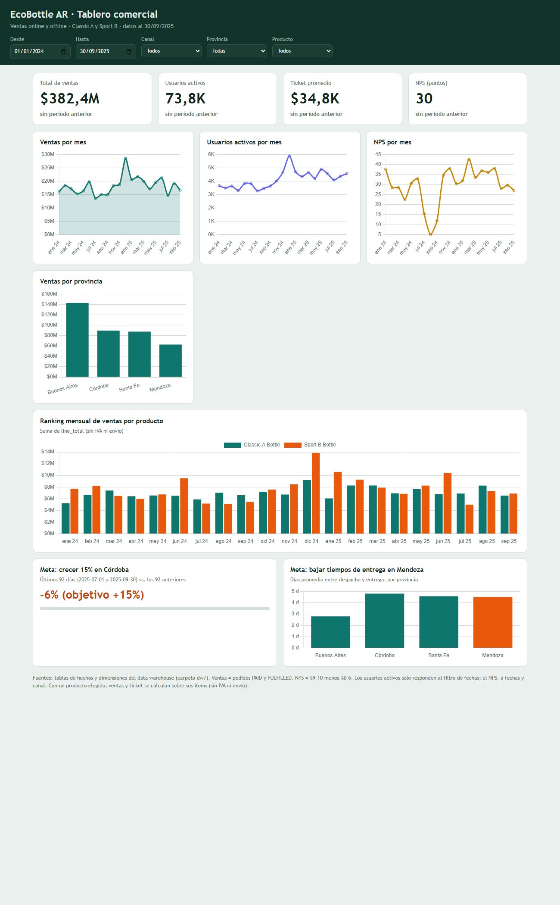
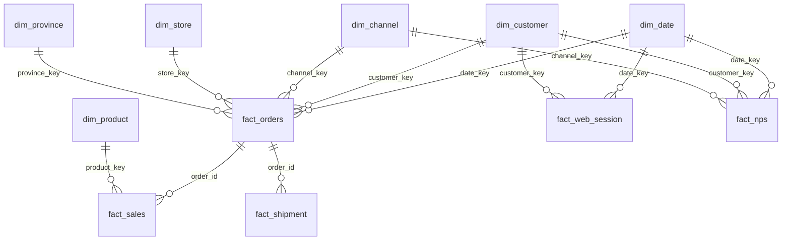

# EcoBottle AR · Mini ecosistema de datos y tablero comercial

Trabajo práctico de **Introducción al Marketing Online y los Negocios Digitales**.

- **Dashboard publicado:** https://valenmonte.github.io/practica-imond/
- **Consigna:** [Práctica](https://docs.google.com/document/d/15RNP3FVqLjO4jzh80AAkK6mUR5DOLqPxLjQxqvdzrYg/edit?usp=sharing)



## 1. El caso

EcoBottle AR vende dos botellas reutilizables (Classic A y Sport B) en una tienda online y en 4 tiendas físicas (Buenos Aires, Córdoba, Santa Fe y Mendoza). La gerencia comercial necesita un tablero para el C-level con el crecimiento de ventas por producto, provincia y canal. Las metas del trimestre son **crecer 15% las ventas en Córdoba** y **reducir los tiempos de entrega en Mendoza**.

Los datos de origen (`raw/`) son una foto del sistema al 30/09/2025 con pedidos del 01/01/2024 al 30/09/2025. Los montos están en pesos argentinos.

## 2. Estructura del repositorio

```
raw/                  datos de origen (13 CSV), no se modifican
sql/                  transformaciones en SQL (DuckDB)
  01_dimensiones.sql  dimensiones del modelo estrella
  02_hechos.sql       tablas de hechos con sus FOREIGN KEY
  03_consultas.sql    controles del modelo y consultas de los KPI
dw/                   data warehouse: un CSV por tabla (se genera solo)
web/data.json         dataset del dashboard (se genera solo)
index.html            dashboard (GitHub Pages)
run_sql.py            ejecuta los SQL y arma el data warehouse
build_dashboard.py    lee dw/ y genera web/data.json
generator/            programa que creó los datos de raw/ (no se usa)
requirements.txt      dependencias (DuckDB)
```

## 3. Cómo ejecutarlo

Requisitos: Python 3.9 o superior y Git.

```
git clone https://github.com/valenmonte/practica-imond.git
cd practica-imond
python -m venv .venv
.venv\Scripts\activate          # Windows  (Mac/Linux: source .venv/bin/activate)
pip install -r requirements.txt
python run_sql.py               # crea warehouse.duckdb y exporta dw/*.csv
python build_dashboard.py       # genera web/data.json
python -m http.server           # abrir http://localhost:8000
```

Otros comandos útiles:

- `python run_sql.py --explorar` abre DuckDB en el navegador con las tablas de `raw/`.
- `python run_sql.py --ui` arma el DW y abre DuckDB con las tablas del modelo.

El dashboard es una página estática (Chart.js) que lee `web/data.json`, por eso funciona en GitHub Pages sin servidor. Reemplaza a Looker Studio.

## 4. Modelo dimensional (esquema estrella, Kimball)

### Modelo de origen (raw)


### Esquema estrella

### Modelo de origen (raw)


### Esquema estrella

Todas las dimensiones tienen clave **subrogada** (`*_key`) y conservan la clave **natural** del sistema de origen (`*_id`). Cada dimensión tiene una fila "Desconocido" con clave `-1` para los hechos sin cliente, sin tienda (pedidos online) o sin dirección de envío.



El diagrama completo, generado automáticamente, está en [`dw/modelo_estrella.md`](dw/modelo_estrella.md).

## 5. Diccionario de datos

### Dimensiones

**dim_date** · una fila por día, del 2024-01-01 al 2025-09-30.

| Columna | Tipo | Descripción |
|---|---|---|
| `date_key` (PK) | INTEGER | Fecha como número, ej. 20240131 |
| `full_date` | DATE | Fecha |
| `year`, `month`, `day`, `quarter` | INTEGER | Partes de la fecha |
| `month_name`, `day_name` | VARCHAR | Nombres (en inglés, como los devuelve DuckDB) |
| `is_weekend` | BOOLEAN | Verdadero para sábado y domingo |

**dim_product** · una fila por producto, con la jerarquía de categorías aplanada.

| Columna | Tipo | Descripción |
|---|---|---|
| `product_key` (PK) | INTEGER | Clave subrogada |
| `product_id` | INTEGER | Clave natural (`raw.product`) |
| `sku`, `name` | VARCHAR | SKU y nombre del producto |
| `category` | VARCHAR | Classic / Sport |
| `family` | VARCHAR | Bottles (categoría padre) |
| `list_price` | DECIMAL(12,2) | Precio de lista, sin IVA |

**dim_province** · una fila por provincia, más la fila `-1` "Sin dato".

| Columna | Tipo | Descripción |
|---|---|---|
| `province_key` (PK) | INTEGER | Clave subrogada |
| `province_id` | INTEGER | Clave natural (0 para "Sin dato") |
| `province_name`, `province_code` | VARCHAR | Nombre y código |

**dim_customer** · una fila por cliente, más la fila `-1` "Desconocido".

| Columna | Tipo | Descripción |
|---|---|---|
| `customer_key` (PK) | INTEGER | Clave subrogada |
| `customer_id` | INTEGER | Clave natural |
| `full_name`, `email` | VARCHAR | Nombre completo y email |
| `status` | CHAR(1) | `A` activo, `I` dado de baja |
| `created_at` | TIMESTAMP | Fecha de alta |

**dim_store** · una fila por tienda física, más la fila `-1` "Online (sin tienda)".

| Columna | Tipo | Descripción |
|---|---|---|
| `store_key` (PK) | INTEGER | Clave subrogada |
| `store_id` | INTEGER | Clave natural |
| `store_name`, `city`, `province` | VARCHAR | Nombre y ubicación (desde `address`) |
| `store_type` | VARCHAR | Física / Online |

**dim_channel** · una fila por canal de venta.

| Columna | Tipo | Descripción |
|---|---|---|
| `channel_key` (PK) | INTEGER | Clave subrogada |
| `channel_id` | INTEGER | Clave natural |
| `channel_code`, `channel_name` | VARCHAR | ONLINE / OFFLINE y su nombre |

### Hechos

**fact_orders** · grano: **un pedido**. Base de Ventas, Ticket Promedio y Ventas por Provincia.

| Columna | Tipo | Descripción |
|---|---|---|
| `order_id` (PK) | BIGINT | Número de pedido |
| `date_key` (FK) | INTEGER | Fecha del pedido → `dim_date` |
| `customer_key`, `channel_key`, `store_key` (FK) | INTEGER | → dimensiones correspondientes |
| `province_key` (FK) | INTEGER | Provincia de la dirección de **envío** → `dim_province` |
| `status` | VARCHAR | CREATED, PAID, CANCELLED, FULFILLED, REFUNDED |
| `is_sale` | BOOLEAN | Verdadero si el estado es PAID o FULFILLED |
| `subtotal`, `tax_amount`, `shipping_fee`, `total_amount` | DECIMAL(12,2) | Importes. `total = subtotal + IVA 21% + envío` |

**fact_sales** · grano: **un producto dentro de un pedido**. Base del ranking por producto.

| Columna | Tipo | Descripción |
|---|---|---|
| `order_item_id` (PK) | BIGINT | Línea del pedido |
| `order_id` (FK) | BIGINT | → `fact_orders` |
| `date_key`, `product_key`, `customer_key`, `channel_key`, `store_key`, `province_key` (FK) | INTEGER | → dimensiones |
| `is_sale` | BOOLEAN | Heredado del pedido |
| `quantity` | INTEGER | Cantidad (> 0) |
| `unit_price`, `discount_amount`, `line_total` | DECIMAL(12,2) | `line_total = cantidad × precio − descuento` |

**fact_web_session** · grano: **una sesión web**. Base de Usuarios Activos.

| Columna | Tipo | Descripción |
|---|---|---|
| `session_id` (PK) | BIGINT | Sesión |
| `date_key` (FK) | INTEGER | Fecha de inicio |
| `customer_key` (FK) | INTEGER | Cliente, o `-1` si es anónimo |
| `source` | VARCHAR | Origen del tráfico (ej. ads, direct, referral) |
| `device` | VARCHAR | Dispositivo |
| `duration_minutes` | DECIMAL(10,2) | Duración (vacía si no hay `ended_at`) |

**fact_nps** · grano: **una respuesta de encuesta**. Base del NPS.

| Columna | Tipo | Descripción |
|---|---|---|
| `nps_id` (PK) | BIGINT | Respuesta |
| `date_key`, `customer_key`, `channel_key` (FK) | INTEGER | → dimensiones (cliente `-1` si es anónima) |
| `score` | SMALLINT | 0 a 10 |
| `category` | VARCHAR | Promotor (9-10), Pasivo (7-8), Detractor (0-6) |

**fact_shipment** · grano: **un envío**. Base de los tiempos de entrega.

| Columna | Tipo | Descripción |
|---|---|---|
| `shipment_id` (PK) | BIGINT | Envío |
| `order_id` (FK) | BIGINT | → `fact_orders` |
| `date_key`, `province_key`, `channel_key` (FK) | INTEGER | Fecha del pedido, provincia de envío y canal |
| `carrier`, `status` | VARCHAR | Correo y estado (READY, SHIPPED, DELIVERED, CANCELLED) |
| `shipped_at`, `delivered_at` | TIMESTAMP | Despacho y entrega |
| `delivery_days` | DECIMAL(10,2) | Días entre despacho y entrega (solo envíos entregados) |

## 6. Definición de los KPI

| KPI | Cálculo |
|---|---|
| Total de ventas | `SUM(total_amount)` de `fact_orders` con `is_sale` (PAID o FULFILLED) |
| Usuarios activos | usuarios distintos en `fact_web_session` (el cliente, o la sesión si es anónima) |
| Ticket promedio | `SUM(total_amount) / COUNT(*)` de los pedidos que cuentan como venta |
| NPS | `(%9-10 − %0-6) × 100` sobre `fact_nps` |
| Ventas por provincia | `total_amount` agrupado por la provincia de la dirección de envío |
| Ranking por producto | `line_total` agrupado por producto y mes |
| Meta Córdoba | ventas de los últimos 92 días vs. los 92 anteriores (objetivo +15%) |
| Tiempo de entrega | promedio de `delivery_days` por provincia |

## 7. Supuestos

- Una **venta** es un pedido en estado `PAID` o `FULFILLED`. Los `CREATED`, `CANCELLED` y `REFUNDED` no cuentan.
- La **provincia** de una venta es la de la dirección de envío. En las compras en tienda es la de la tienda. Los pedidos sin dirección quedan en "Sin dato".
- `total_amount` incluye IVA y envío. El ranking por producto usa `line_total`, que no los incluye.
- Con un producto seleccionado en el dashboard, ventas y ticket se calculan sobre sus ítems (sin IVA ni envío).
- Los **usuarios activos** solo responden al filtro de fechas, porque `web_session` no tiene canal, provincia ni producto. El **NPS** responde a fechas y canal, porque la encuesta no tiene número de pedido.
- El **tiempo de entrega** se mide entre `shipped_at` y `delivered_at`, solo para envíos entregados.
- `raw.customer` no tiene dirección: la provincia no se guarda en `dim_customer` y se toma siempre del pedido.
- El período de datos es del 01/01/2024 al 30/09/2025. Para comparar contra el período anterior, el dashboard usa un rango de igual duración inmediatamente anterior.

## 8. Consultas clave

Las consultas completas están en [`sql/03_consultas.sql`](sql/03_consultas.sql). Dos ejemplos:

```sql
-- Ventas por provincia de envío
SELECT pr.province_name, SUM(f.total_amount) AS ventas
FROM fact_orders f JOIN dim_province pr USING (province_key)
WHERE f.is_sale
GROUP BY pr.province_name
ORDER BY ventas DESC;

-- Ranking mensual por producto
SELECT d.year, d.month, p.name AS producto, SUM(s.line_total) AS ventas,
       RANK() OVER (PARTITION BY d.year, d.month ORDER BY SUM(s.line_total) DESC) AS ranking
FROM fact_sales s JOIN dim_product p USING (product_key) JOIN dim_date d USING (date_key)
WHERE s.is_sale
GROUP BY d.year, d.month, p.name
ORDER BY d.year DESC, d.month DESC, ranking;
```

## 9. Hallazgos

- En todo el período (ene 2024 a sep 2025) las ventas suman $382,4M, con un ticket promedio de $34,8K y un NPS de 30 puntos.
- Las ventas mensuales se mueven entre $13M y $20M, con un pico cercano a $28M en enero de 2025.
- El NPS cayó a casi 5 puntos hacia septiembre de 2024 y se recuperó desde noviembre de ese año.
- Los envíos a Buenos Aires tardan unos 2,8 días, contra 4,5 a 4,8 días en Córdoba, Santa Fe y Mendoza. Mendoza, que tiene meta de reducción, no se diferencia de las otras provincias del interior.
- **Meta Córdoba:** las ventas de los últimos 92 días cayeron 6,0% frente a los 92 anteriores, así que la meta de +15% no se alcanzó.
- **Idea nueva:** agregar al tablero las sesiones por origen del tráfico (ads, direct, referral) para medir qué campañas traen más usuarios activos.

## 10. Convenciones del repositorio

- Entorno virtual (`.venv`) con dependencias en `requirements.txt`.
- Commits con [Conventional Commits](https://www.conventionalcommits.org/es/): `feat`, `fix`, `docs`, `chore`.
- Toda la gestión del repositorio se hace desde la consola.
